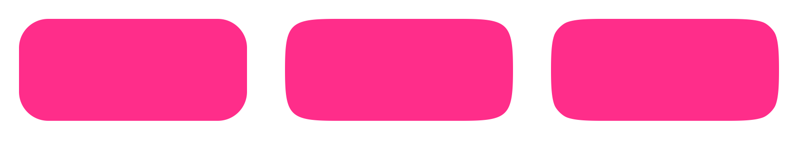

# Safari Squircle Fallback (VI-839)

Safari 27.2 (macOS) and every iOS browser report `CSS.supports("corner-shape", "squircle")` false, so a squircle theme draws round there. Playwright's WebKit has no `corner-shape` either and stands in for Safari in every check below.

## The Problem in One Line

A squircle of radius R bulges past a circle of radius R at every corner. A clip can only remove paint, so clipping a round box never makes a squircle. Something has to paint more, and whatever paints more must not cut off borders, focus rings or shadows.

## Options Tried

| Option | Fill | Border | Focus ring | Shadow | Cost | Verdict |
|---|---|---|---|---|---|---|
| `clip-path: shape()` on a square box (`border-radius: 0`) | Exact | Lost along the curve (a square border cut by the curve) | Clipped away | Clipped away | One rule | Rejected |
| Same, plus a `::before` / `::after` layer for ring and border | Exact | Needs the border colour on the pseudo for every state | Needs the ring colour per state | Survives | Per-state duplication; `<input>` has no pseudo-elements; Button's `::after` already draws its edge (VI-655) | Rejected |
| SVG `mask` (or `-webkit-mask-box-image` nine-slice) | Exact, and `mask-size: auto 50%` clamps pills for free | Same as the clip | Masked away | Masked away | One rule | Rejected: the mask covers the whole painted element |
| JS polyfill (per-element `clip-path: path()` from a ResizeObserver) | Exact | Same as the clip | Clipped | Clipped | Script on every page, a pass over every rounded element | Rejected; no maintained one found that keeps rings and shadows |
| **Circle at 0.54 R, clip only the sliver, edges on a squircle ring layer** | Exact | Exact where a pseudo-element can carry it; the circle on `<input>` | Kept, follows the circle | Kept, follows the circle | One `--squircle-r` per component, a ring layer per edged component | **Chosen** |

## How the Chosen One Works

1. The element draws `border-radius: 0.54 × R`. That is the largest circle that still holds the whole squircle of radius R (measured: at 0.54 the circle contains the squircle; at 0.56 it already falls 0.7% of R inside it). It differs from the squircle by at most 1.6% of R, under half a pixel on Honcho's 54px pill.
2. `clip-path: shape()` removes only what that circle draws outside the squircle, plus a quarter pixel so the circle's antialiased rim never shows as a seam. The clip is a huge rectangle with the circle cut out and the squircle put back (non-zero winding), so everything outside the box survives: focus rings, outer shadows, halos.
3. Edges are redrawn on a pseudo-element clipped to `--squircle-ring` (the squircle minus the squircle inset by the edge): Button's and Chip's `::after` edge as a square outline thick enough to cover the ring's corners, SegmentedControl's track edge and pill ring, ToggleGroup's track border. The element hides its own edge (`--squircle-edge-off`). A first pass left the edge on the circle; at R = 24 it thinned by up to 40% along the curve and read as a double edge at 4x, so it was replaced.
4. The squircle is one cubic per corner with handles at 0.082 R, within 0.5% of R of `superellipse(2)` (best fit over handle positions 0.04 to 0.12).
5. R must be clamped to half the height, as the browser clamps a radius. `shape()` cannot do that across axes (x percentages read the width), so each component sets `--squircle-r` from its own radius and height tokens.

The shared part lives in the theme engine (`SQUIRCLE_FALLBACK` in `packages/theme-engine/src/generate-css.ts`) and ships in a squircle theme's `visor-base` layer. It is gated twice: `@supports not (corner-shape: squircle)`, so Chromium keeps the native corner and the fallback switches itself off when Safari ships it, and `@container style(--corner-shape: squircle)`, so round themes and round subtrees are untouched.

The spike image shows why the circle must hold the squircle: at 0.57 R (right) the two curves cross and the corner picks up a visible kink. At 0.54 R the circle sits outside the squircle everywhere and the clip alone draws the edge.

## Evidence

Paper with `corners: squircle` (radii 10 to 28px, pill buttons and tabs rail) and Paper as shipped (round), light and dark. Each image is the top-left corner at 4x, Chromium (native `corner-shape`) on the left, WebKit (fallback) on the right. The Honcho theme was checked the same way locally; its crops stay out of this public repo.

| Surface | Crops |
|---|---|
| Button fill (pill) | [crop-button-fill.png](VI-839/crop-button-fill.png) |
| Button border (outline, lg) | [crop-button-border.png](VI-839/crop-button-border.png) |
| Button focus ring | [crop-button-focus.png](VI-839/crop-button-focus.png) |
| Input border (round in Safari) | [crop-input-border.png](VI-839/crop-input-border.png) |
| Input focus ring and halo (round in Safari) | [crop-input-focus.png](VI-839/crop-input-focus.png) |
| Card shadow (round in Safari) | [crop-card-shadow.png](VI-839/crop-card-shadow.png) |
| SegmentedControl track and pill | [crop-segmented-track.png](VI-839/crop-segmented-track.png) |
| Tabs rail and trigger (round in Safari) | [crop-tabs-rail.png](VI-839/crop-tabs-rail.png) |
| Dialog panel and shadow | [crop-dialog-shadow.png](VI-839/crop-dialog-shadow.png) |
| Meter track and fill | [crop-meter-track.png](VI-839/crop-meter-track.png) |

Measured in WebKit on the squircle theme, nested corners stay concentric (inner = outer − inset, same squircle on both): SegmentedControl 14 − 5 = 9px, Meter 5 − 2 = 3px; with Honcho's pill track, 18 − 3 = 15px. Chromium gives the same numbers.

The proof that runs in CI is `components/ui/__tests__/squircle-fallback.test.ts` (Chromium and WebKit, `VISOR_REQUIRE_BROWSER` in the concentric job) and the WebKit project of the concentric scan.

## Limits

- Inputs, cards and tabs stay round in Safari. Focus rings and shadows follow the 0.54 R circle, so a shadow starts up to 1.6% of R (plus a quarter pixel) outside the squircle edge. On a shadow that hugs the box (Input's focus halo, Card's and the active tab's `--shadow-sm`) that showed as a hairline of page at the corner, visible at 4x. Safari cannot shape a box-shadow to a clip, and `filter: drop-shadow()` cannot stand in for it on the same element: filters run before `clip-path`, so the drop-shadow is cast by the circle and the seam stays. Round is what Safari draws today; a seam is not, so these three opt out. (`<input>` also has no pseudo-element to carry a ring.)
- `--squircle-r` must be clamped by the component; a box with no known height needs a height token.
- `--corner-shape: round` on the element itself is not seen (the style query reads the parent); on an ancestor it works.
- Only the components listed in the theming docs opt in. A consumer's own rounded box stays round in Safari until it adds the three lines.
- A browser with neither `corner-shape` nor style queries draws round.

## What Consumers Must Change

- **low-orbit-studio** `src/components/space/look-switch.module.css` and the trial scope in `client-theme.module.css`: they set `corner-shape` themselves. Visor components inside a squircle theme scope get the fallback for free; any hand-rounded box there needs `--squircle-r`, `border-radius: var(--squircle-radius, var(--squircle-r))` and `clip-path: var(--squircle-clip, none)` inside the same two gates. The scope must carry a squircle theme (so the theme's base layer defines `--squircle-radius` and `--squircle-clip`), not only `--corner-shape: squircle`.
- **honcho-planning** `public/docs/look.js` and `public/docs/look.css` (`:where(*) corner-shape: squircle`): no theme engine output there, so the page must import the theme CSS that carries `SQUIRCLE_FALLBACK` (or paste it), then opt each rounded element in as above. Updating to the Visor release with this change gives the Visor components the fallback.
